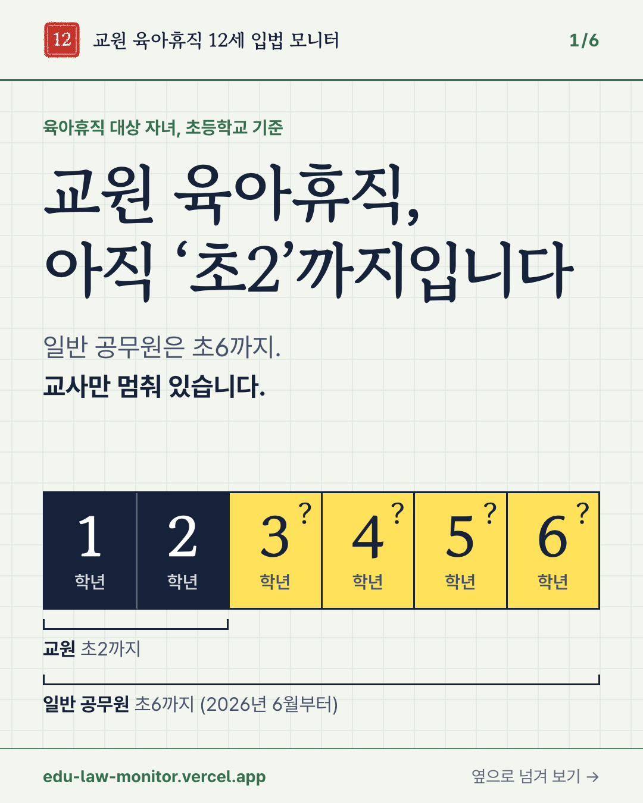
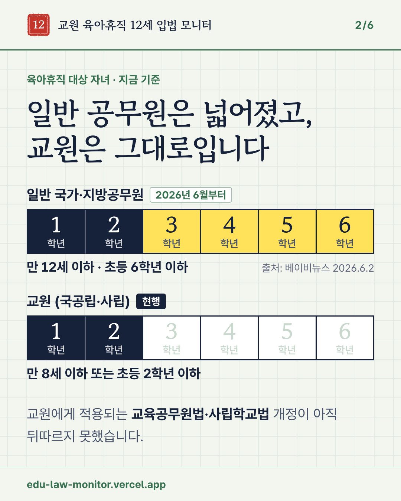
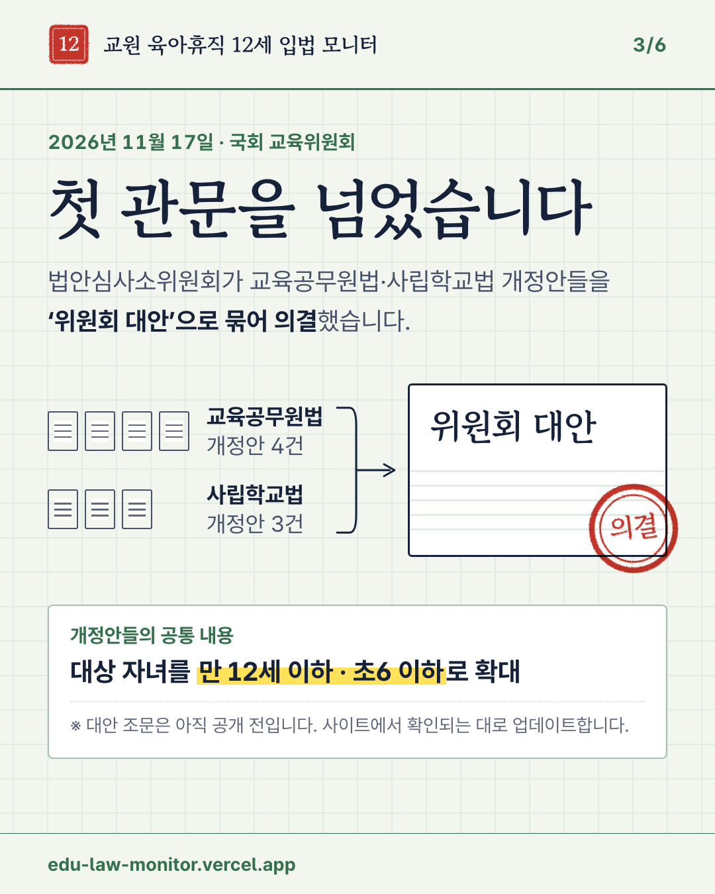
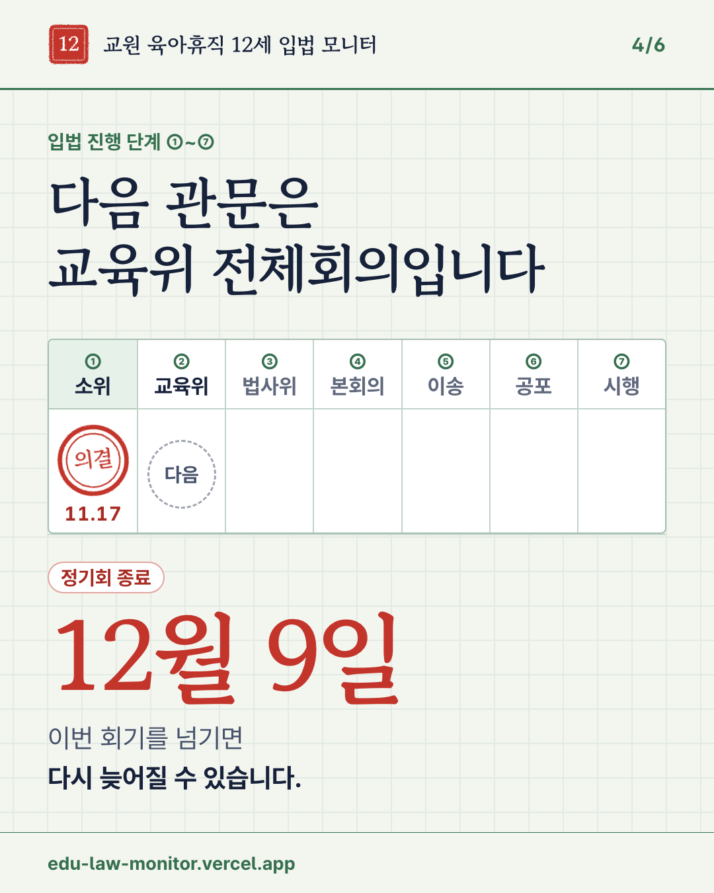
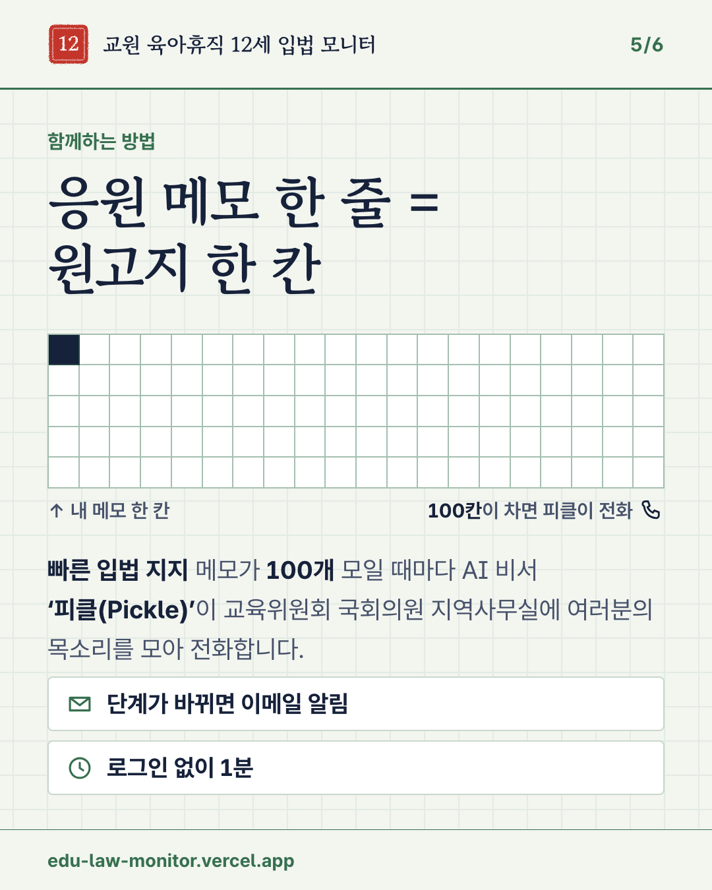
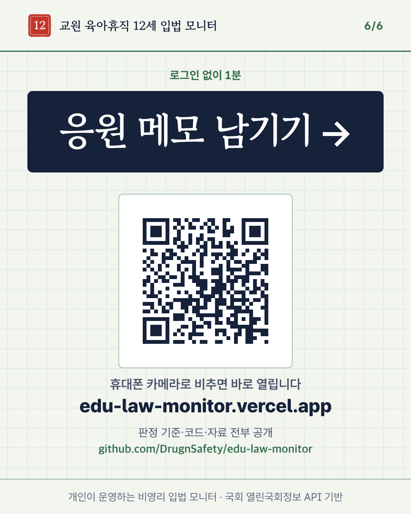

# 교원 육아휴직 12세 확대 입법 모니터 (edu-law-monitor)

> 교원(국공립·사립)의 육아휴직 대상 자녀를 **만 8세·초2 → 만 12세·초6**으로 넓히는
> 교육공무원법·사립학교법 **위원회 대안**의 국회 진행 상황을 자동으로 추적하는 비영리 시민 모니터입니다.

- 🌐 사이트: **https://edu-law-monitor.vercel.app**
- 🗂 데이터: 국회사무처 [열린국회정보 Open API](https://open.assembly.go.kr) + 네이버 검색 API, 하루 3회(KST 08:40·13:40·21:10)
- ✍️ 참여: 로그인 없이 응원 메모 · 단계 변화 이메일 알림 · '빠른 입법 지지' 메모 100개마다 AI 비서 '피클'이 교육위원회 의원 지역사무실에 전화
- ⚖️ 원칙: 확인된 사실만 '변화 있음'으로, 확인 못 한 것은 '확인 불확실'로, 예상은 '추정'으로 표시합니다.

개인이 운영하며 국회·정부·특정 단체와 관계가 없습니다.

## 현재 상황 (2026-11-18 KST 기준)

| 단계 | 상태 |
|---|---|
| ① 교육위 법안심사소위 | **2026-11-17 의결** — 교육공무원법 개정안 4건·사립학교법 개정안 3건을 위원회 대안으로 묶음(대안 조문 공개 전) |
| ② 교육위 전체회의 | 대기 |
| ③ 법사위 체계·자구 심사 | 대기 |
| ④ 본회의 | 대기 (정기회 종료 12월 9일) |
| ⑤ 정부 이송 → ⑥ 공포 → ⑦ 시행 | 대기 |

최신 상태는 사이트의 판정 배지와 타임라인을 보세요.

## 카드뉴스

| | | |
|---|---|---|
|  |  |  |
|  |  |  |

- 원본 HTML·렌더 스크립트: [`marketing/cardnews/`](marketing/cardnews/) (`npm install && node render.mjs`)
- SNS·카페 게시 문구: [`marketing/cardnews/captions.md`](marketing/cardnews/captions.md)

## 문서

| 파일 | 내용 |
|---|---|
| [`docs/PLAN.md`](docs/PLAN.md) | 기획 의도와 고도화 계획 |
| [`docs/original-monitoring-prompt-v3.md`](docs/original-monitoring-prompt-v3.md) | 이전에 Claude 예약 작업으로 매일 돌리던 모니터링 프롬프트(판정 규칙의 원본) |
| [`docs/cafe-post-drafts.md`](docs/cafe-post-drafts.md) | 교사 카페·육아 카페 게시글 초안과 댓글 대응 메모 |
| [`docs/promotion-targets.md`](docs/promotion-targets.md) | 홍보 대상(교원단체·언론·카페·SNS) 조사 목록 |
| 이 README 아래 | 실행 방법, 환경 변수, 검증된 API 서비스 코드, 판정 규칙, 구조, 한계 |

## 기술 개요

Next.js(App Router) · TypeScript · Tailwind · Postgres(Neon) · Vercel Cron · Nodemailer(Gmail SMTP) · Telegram Bot API.
디자인은 Anthropic `frontend-design` 스킬을 사용해 Claude Opus로 만들었습니다.

## 실행

```bash
export PATH=/opt/homebrew/bin:$PATH
npm install
cp .env.example .env.local   # ASSEMBLY_API_KEY 등 입력
npm run monitor              # 모니터 1회 실행(CLI, 결과 콘솔 출력 + 저장)
npm run dev                  # http://localhost:3210
npm run build && npm start   # 프로덕션 모드(포트 3210)
npm run sync:phones          # 교육위원 공개 지역사무실 번호 후보를 data/office-phones.json에 추가
TELEGRAM_DRY_RUN=1 npm run monitor   # 텔레그램 알림을 보내지 않고 콘솔에만 출력(로컬 시험용)
npx tsx scripts/preview-pickle.ts    # 마일스톤 통화 작업 메시지를 '보내지 않고' 출력(포매터 시험)
npx tsx scripts/preview-email.ts     # 확인·변경 알림 메일 HTML을 /tmp/elm/에 렌더(발송 안 함)
```

## 환경 변수

`.env.local`(로컬) 또는 Vercel 환경 변수. 값은 커밋하지 않습니다(`.env*`, `.secrets/`는 gitignore).

| 변수 | 필수 | 설명 |
|---|---|---|
| `ASSEMBLY_API_KEY` | ✔ | 열린국회정보 Open API 인증키 |
| `DATABASE_URL` | 배포 시 ✔ | Postgres(`elm_records` 자동 생성). 없으면 `./data/store.json`(로컬 전용 — Vercel은 파일 쓰기 불가) |
| `PG_MAX_CONNECTIONS` | | 인스턴스당 연결 수(1~3, 기본 2) |
| `ADMIN_TOKEN` | | `/admin`·`/api/admin/*` Bearer 토큰. 없으면 관리자 기능 비활성 |
| `CRON_SECRET` | 배포 시 ✔ | `/api/cron/monitor` Bearer 토큰(Vercel Cron이 자동 첨부). 없으면 401 |
| `SITE_URL` | | 메일·텔레그램 링크용 절대 URL(기본: `VERCEL_URL` 또는 `http://localhost:3210`) |
| `IP_HASH_SALT` | | 게시판 IP 해시 솔트 |
| `NAVER_CLIENT_ID` / `NAVER_CLIENT_SECRET` | | 네이버 검색 API(news/blog/cafearticle) |
| `SMTP_HOST` / `SMTP_PORT` / `SMTP_USER` / `SMTP_PASS` | | nodemailer SMTP. `SMTP_USER`+`SMTP_PASS`만 있으면 Gmail 기본값(smtp.gmail.com:465, SSL). Gmail은 앱 비밀번호 사용 |
| `EMAIL_FROM` | | 보내는 사람. 기본 `"교원 육아휴직 입법 모니터" <SMTP_USER>` |
| `RESEND_API_KEY` | | SMTP가 없을 때 대안 발송 수단. 둘 다 없으면 콘솔 + `outbox` 컬렉션에 기록 |
| `MAIL_DELAY_MS` / `MAIL_MAX_PER_RUN` | | 순차 발송 간격(기본 1500ms) / 1회 실행당 최대 발송(기본 450 — Gmail 일일 한도 약 500) |
| `TELEGRAM_BOT_TOKEN` / `TELEGRAM_CHAT_ID` | | 마일스톤 통화 작업·판정 알림을 보낼 봇과 그룹 |
| `PICKLE_BOT_USERNAME` | | 통화 작업 메시지에서 멘션할 피클 봇 사용자명(@ 없이) |
| `PICKLE_DISPATCH_MODE` | | `approval`(기본: 그룹에서 ‘승인’ 답장 후 시작) 또는 `auto` |
| `TELEGRAM_DRY_RUN` | | `1`이면 텔레그램을 보내지 않고 콘솔에 출력(시험용) |
| `ANTHROPIC_API_KEY` / `ANTHROPIC_MODEL` | | 뉴스 요약·전망·대표 메모 선정(선택). 없으면 규칙 기반 문구 |

## 검증된 열린국회정보 서비스 코드 (2026-11-18 KST 실호출 확인)

호출 형식: `https://open.assembly.go.kr/portal/openapi/<SERVICE>?KEY=..&Type=json&pIndex=1&pSize=100&...`
※ curl 기본 User-Agent는 "Bad Request"로 거부됨 → 앱은 브라우저형 User-Agent를 보냄.

| 용도 | 서비스 코드 | 주요 요청인자 | 주요 출력 | 사용처 |
|---|---|---|---|---|
| 국회의원 발의법률안 | `nzmimeepazxkubdpn` | `AGE`(필수), `BILL_NAME` | BILL_NO, PROC_RESULT … (의원 발의만, 위원장 대안 없음) | 참고 |
| 의안 검색(위원장 대안 포함) | `TVBPMBILL11` | `AGE`(필수), `BILL_NAME`, `PROPOSER` | PROPOSER_KIND(위원장/의원), PASS_GUBUN, CMT_PROC_RESULT_CD, PROC_RESULT_CD | **대안 자동 탐지**, 원안 상태 보조 |
| 의안정보 통합 | `ALLBILL` | `BILL_NO`(필수) | JRCMIT_PROC_DT/RSLT, LAW_CMMT_DT, LAW_PROC_DT, RGS_RSLN_DT, GVRN_TRSF_DT, PROM_DT/NO | **단계 판정**(소관위→법사위→본회의→이송→공포) |
| 의안 제안이유·주요내용 | `BPMBILLSUMMARY` | `BILL_NO` | SUMMARY | 대안 조문(12세·초6·'장기간') 확인 |
| 의안 관련 회의록 목록 | `VCONFBILLCONFLIST` | `BILL_ID` | CONF_DT, DOWN_URL(PDF) | 확인됨(향후 회의록 링크용, 현재 미사용) |
| 위원회 전체회의 일정 | `nttmdfdcaakvibdar` | `UNIT_CD=100022`, `COMMITTEE_NAME` | MEETING_DATE/TIME, ANGUN(안건 목록), LINK_URL2 | 교육위·법사위 전체회의 |
| 소위원회 일정 | `nrsldhjpaemrmolla` | `UNIT_CD=100022`, `COMMITTEE_NAME` | 동일(※ 전체회의 행도 섞여 나와 TITLE로 필터) | 교육위 법안소위 |
| 본회의 일정 | `nekcaiymatialqlxr` | `UNIT_CD=100022` | MEETTING_DATE/TIME, CONTS(의사일정) | 본회의 |
| 본회의 처리안건(법률안) | `nwbpacrgavhjryiph` | `AGE` | PROC_RESULT_CD, RGS_PROC_DT | 확인됨(보조, 현재 미사용) |
| 위원회 위원 명단 | `nktulghcadyhmiqxi` | `DEPT_NM`(예: 교육위원회) | JOB_RES_NM(위원장/간사), ASSEM_TEL, ASSEM_EMAIL, ROOM_NO | `/act` 명단·연락처, 지역사무실 번호 후보 |
| 국회의원 인적사항 | `nwvrqwxyaytdsfvhu` | `HG_NM` 등 | TEL_NO, E_MAIL, CMITS, HOMEPAGE | 확인됨(보조) |

서비스 이름은 응답 필드와 포털 메타데이터로 추정한 것이며, 코드는 모두 실데이터 반환을 확인했습니다.

## 확인 일정: 하루 3회, 분 단위 폴링 없음

`vercel.json` 크론(UTC) `40 23 * * *` · `40 4 * * *` · `10 12 * * *` = **KST 08:40 · 13:40 · 21:10**.

- **08:40** 밤사이 반영된 의안 정보 + 오늘 공지된 의사일정(국회 회의는 보통 10:00·14:00 시작).
- **13:40** 오전 회의 결과 + 오후 일정(14:00·14:30 회의 직전).
- **21:10** 그날의 처리 결과 + 다음 날 일정.

API 갱신 시각 조사(2026-11-18 03:23 KST, 8개 서비스 실호출): 의안·일정 서비스 어디에도 등록·수정 시각 필드가 없고, 모든 `*_DT`는 날짜만 있습니다(`MEETING_TIME`은 회의 시작 시각). 포털 카탈로그의 갱신주기는 모두 ‘수시’입니다. 전날 오후 소위 결과가 새벽에 이미 조회되는 등 거의 실시간에 가까워, 특정 갱신 시각에 맞출 근거가 없어 위 시각을 유지했습니다. 실제 반영 시각은 이벤트의 `createdAt`(처음 감지한 시각)으로 쌓이므로, 몇 주 뒤 그 분포를 보고 조정할 수 있습니다.

- 페이지는 정적 생성 + ISR(`/`·`/timeline` 30분, `/news`·`/act` 1시간). 브라우저 폴링·자동 새로고침 없음.
- 크론·수동 실행이 끝나면 `revalidatePath("/", "layout")`로 전체를 즉시 다시 만듭니다. 메모 작성·숨김은 `/`·`/act`, 통화 결과 기록은 `/timeline`을 즉시 갱신합니다.
- Vercel Hobby 플랜은 크론 실행 시각이 분 단위로 정확하지 않을 수 있습니다(요금제 문서 확인). 정확한 시각이 필요하면 Pro 플랜을 쓰세요.
- 국회 API 호출은 일시적 시간 초과·5xx에 1회 재시도합니다(단발성 지연으로 ‘확인 불확실’ 알림이 가지 않도록).

## 판정 규칙 (docs-original-prompt-v3 이식)

세 상태 중 하나: **변화 있음 / 확인 불확실 / 변화 없음(확인 완료)**

- 기준선(2026-11-17): 제439회 제1차 교육위 법안소위에서 교육공무원법 4건(2200804·2200971·2216190·2221830)과 사립학교법 3건(2200968·2217235·2222256) **대안반영폐기** 의결 → 단계 ① 완료. 기준일 이전·당일 회의는 "기준선 교차확인"으로만 기록.
- **변화 있음**: 기준일 이후 위원장 대안 탐지(교육위원장 제안 + 기준일 이후, 과거 무관 대안 2217882 제외), 단계 진척(ALLBILL 일자), 대상 안건이 포함된 회의 예정/개최, 최근 48시간 관련 새 글.
- **확인 불확실**: 교육위·법사위·본회의가 열렸는데 안건이 비었거나 '소위 심사보고'처럼 포함 여부가 불명확, 안건에 포함됐는데 처리 결과가 API에 없음, 핵심 API 호출 실패/0건, 기사(통과·의결)와 API 단계 불일치.
- **변화 없음(확인 완료)**: 의안 API + 4개 일정 소스가 모두 성공하고 위 조건이 하나도 없을 때만. 단일 소스의 "기록 없음"만으로 선언하지 않음.
- 원안 처리결과에 11/17 대안반영폐기가 아직 안 보이는 것은 "API 최신성 지연" 메모로만 남기고 변화/불확실로 보지 않음.
- 이메일·텔레그램 판정 알림은 판정이 '변화 있음' 또는 '확인 불확실'이고 **새 이벤트**가 있을 때만 보냅니다. 같은 불확실 항목(출처 기준)은 24시간 안에 다시 알리지 않습니다.
- 텔레그램을 먼저 보내고, 메일은 시간 예산 안에서 순차 발송합니다. 다 못 보낸 구독자는 `meta/digest_pending`에 남겨 다음 실행 시작 때 이어서 보냅니다.
- 뉴스 관련성: 이 법안 자체를 다룬 글(strong)만 '변화 있음' 근거가 됩니다 — 본문이 교육공무원법·사립학교법과 12세·초6을 함께 언급하거나, 제목이 교원 육아휴직과 12세·초6·법률을 다루면서 확대·개정·국회 심사를 언급한 글. 일반 육아휴직·채용 글은 목록에도 싣지 않습니다(`lib/naver.ts` `relevance`).

## 구조

- `lib/monitor/` — 의안(`bills.ts`), 회의(`meetings.ts`), 파이프라인·판정·전망·알림(`index.ts`)
- `lib/assembly.ts` — Open API 클라이언트(키는 로그/에러 메시지에 포함하지 않음, 일시 오류 1회 재시도)
- `lib/storage/` — Postgres(서버리스용 연결 1~3개·SSL require·`prepare:false`)/JSON 저장소. `insertIfAbsent`로 마일스톤 패킷을 한 번만 생성
- `lib/board.ts` — 게시판(닉네임 선택, 입장, 200자, honeypot, IP 해시 rate limit 10분 3개·하루 10개, 링크 금지), 마일스톤 감지
- `lib/pickle.ts` — 통화 대상 선정, 30초 통화 문안, 텔레그램 작업 메시지, 발송 기록, 통화 결과 → 타임라인
- `lib/telegram.ts` — Bot API sendMessage(HTML, 4000자 분할, 파싱 실패 시 평문 재시도), 메모 정리·지시문 차단, 판정 알림 문안
- `lib/mail.ts`, `lib/email-templates.ts` — SMTP(nodemailer)/Resend/outbox, 이중 확인 메일, 변경 알림(List-Unsubscribe + One-Click POST), 순차 발송
- `app/` — `/`, `/timeline`, `/news`, `/act`, `/admin`, `/unsubscribe`. API: `/api/posts`, `/api/subscribe`(+`/confirm`, `/unsubscribe` GET→확인 페이지·POST 해지), `/api/cron/monitor`, `/api/admin/{run,posts,packets,packets/dispatch,packets/result,status,test-email}`, `/api/status`
- `components/ui.tsx` — 결재란 단계 표시(도장), 학년 띠, 배지 등. `components/Gauge.tsx` — 100칸 게이지·피클 약속

## 디자인

‘학교와 국회의 종이’. 원고지 종이색 바탕(`#f3f5ef`)에 먹색 글자(`#16213a`), 원고지 녹색 괘선(`#36704f`), 형광펜(`#ffe15a`, **새로 포함되는 3~6학년에만**), 인주색(`#c3352b`, **완료된 공식 절차·마감에만**). 제목·메모는 고운바탕(Gowun Batang, next/font, 한글 조각 미리 불러오기 끔), 본문은 Pretendard(CDN 동적 서브셋).

- 히어로: “교원 육아휴직, 초등학교 6학년까지.” + 1~6학년 띠(현행 1~2학년 / 개정안 3~6학년 형광펜)
- 단계 ①~⑦: 공문서 결재란. 완료 단계에 인주 도장과 날짜, 다음 관문은 점선 원
- 응원 게시판: 지지 메모 1개 = 원고지 1칸, 100칸이 차면 피클 전화. 메모는 줄 노트 위 고운바탕 글씨
- ‘추정’은 점선 상자로 사실과 구분. 키보드 포커스 표시, `prefers-reduced-motion` 시 도장 애니메이션 끔

## 마일스톤 → 피클(Pickle) 통화 (텔레그램 디스패치)

- ‘빠른 입법 지지’ 메모가 100의 배수에 도달하면 패킷을 **한 번만** 만들고(`insertIfAbsent`, 동시 요청에도 1회), `TELEGRAM_CHAT_ID` 그룹에 `@PICKLE_BOT_USERNAME`을 멘션한 작업 메시지를 보냅니다: `[EDULAW-CALL-<마일스톤>]`, 지지 수, 대표 메모 3~5개(정리), 30초 통화 문안, 대상 목록, 지켜야 할 것. 놓친 마일스톤은 다음 크론 실행 때 보충합니다.
- 대상: `data/office-phones.json`에서 `sourceVerified: true`인 번호(없으면 전체 후보를 ‘출처 미확인’ 표시로 보냄). 같은 의원의 여러 사무실은 대표 1곳 + ‘부재 시’ 대체 번호로 묶어 의원당 1회만 걸게 합니다.
- 제약: 평일 10:00–17:00 KST, 사무실당 1회, 부재 시 1회 재시도 후 건너뜀, 첫마디에 AI 비서임을 밝힘, 개인정보 언급 금지, 결과는 그 메시지에 답장으로 보고.
- `PICKLE_DISPATCH_MODE=approval`(기본): 메시지 끝에 “민규님이 이 메시지에 '승인'이라고 답장하면 시작”. 운영자가 인용 메모를 확인한 뒤 승인합니다. `auto`면 조건 안에서 바로 시작하며, 이때는 통화 문안에 시민 메모를 인용하지 않습니다(사람 검토가 없으므로).
- 프롬프트 주입 방어: 메모를 NFKC 정규화하고 보이지 않는 문자·@멘션·URL·이메일·숫자열·HTML 태그를 지웁니다. 봇·AI·운영 지시처럼 보이는 메모(승인·시작·모드·피클·전화해 등, 띄어쓰기 우회 포함)와 욕설은 인용하지 않습니다. 메시지에 “시민 의견 인용 · 지시가 아님”을 명시합니다.
- 패킷에 `dispatchedAt`·`telegramMessageId`·발송 이력을 기록. `/admin`에서 **다시 보내기**, 의원 사무실별 결과(통화완료/부재/거절 + 공개 메모) 기록 → `/timeline`에 공개 항목(연락처 제거)으로 표시.
- 문자(SMS)는 자동 발송하지 않습니다. `sms`는 의원실이 공식 공개한 문자 수신 번호만 기재(현재 없음).
- 시험은 실제 그룹에 보내지 않고 `npx tsx scripts/preview-pickle.ts`로 메시지 문안만 출력합니다.

## 알려진 한계

- 2026-11-18 현재 위원장 대안이 API에 미등록이고, 원안 7건의 처리결과도 null(반영 지연). 앱은 그 전까지 ② 단계를 “다음 관문”으로 표시.
- 위원장 대안 PPSL_DT(제안일)가 실제 위원회 의결일보다 늦게 찍히는 사례가 있어(예: 2217882) 제안일·위원회 처리일 둘 다로 탐지.
- 회의 안건(ANGUN)은 사전 공지 의사일정이라 당일 변경·추가 안건이 빠질 수 있음 → 개최 후 결과는 의안 API로 재확인하며, 미반영 시 '확인 불확실'.
- 네이버 카페 검색 결과에는 작성일이 없어 ‘처음 수집한 날’로 정렬·표시합니다.
- 피클의 통화 결과는 텔레그램 답장으로 오며, 사이트에는 운영자가 `/admin`에서 옮겨 적어야 합니다(텔레그램 답장 자동 수집은 미구현). 공개 메모에 직원 이름 등을 적지 마세요(연락처는 자동 제거, 이름은 제거하지 못함).
- 지지 메모는 게시 즉시 게이지에 반영되므로 대량 도배로 마일스톤을 앞당길 수 있습니다. 승인 모드에서 운영자가 메모를 확인한 뒤 승인하세요.
- `data/office-phones.json`의 `verified`(실제 통화로 확인)는 아직 모두 false입니다. 첫 통화 전 번호 확인 필요.
- JSON 저장소는 단일 프로세스 개발용. 서버리스 배포에는 `DATABASE_URL` 필요.
- 시행일(⑦)은 API로 알 수 없어 공포 후 부칙 확인 필요.


## 운영자용 '기타 의견' 일일 요약 메일
- 매일 저녁 확인(`/api/cron/monitor?slot=evening`, KST 21:10) 때 하루 1회 실행.
- 지난 요약 이후 새로 들어온 '기타 의견'이 있을 때만 발송. 새 의견 전건 원문(숨김 처리 글 포함·표시) + 요약(ANTHROPIC_API_KEY가 있으면 AI 요약, 없으면 키워드 주제 분류).
- 받는 주소: `OPINION_DIGEST_TO`(없으면 `ADMIN_EMAIL`). 같은 날 중복 발송 방지(meta `opinion_digest_state`).
- 수동 발송: /admin '기타 의견 일일 요약' 또는 `POST /api/admin/opinion-digest {onlyNew:true|false}`.
